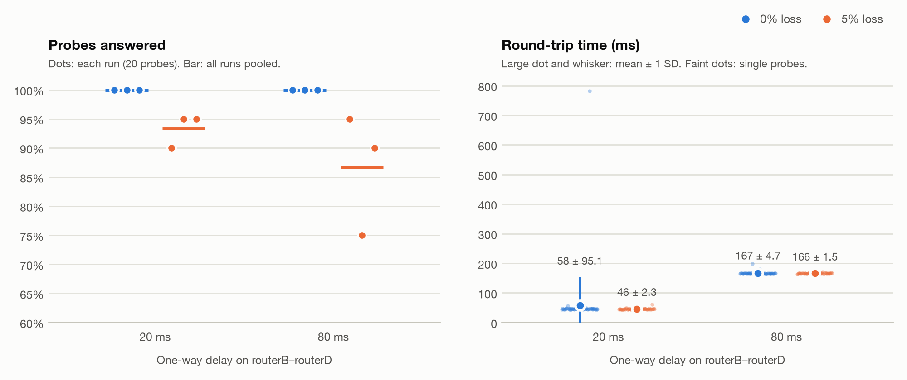
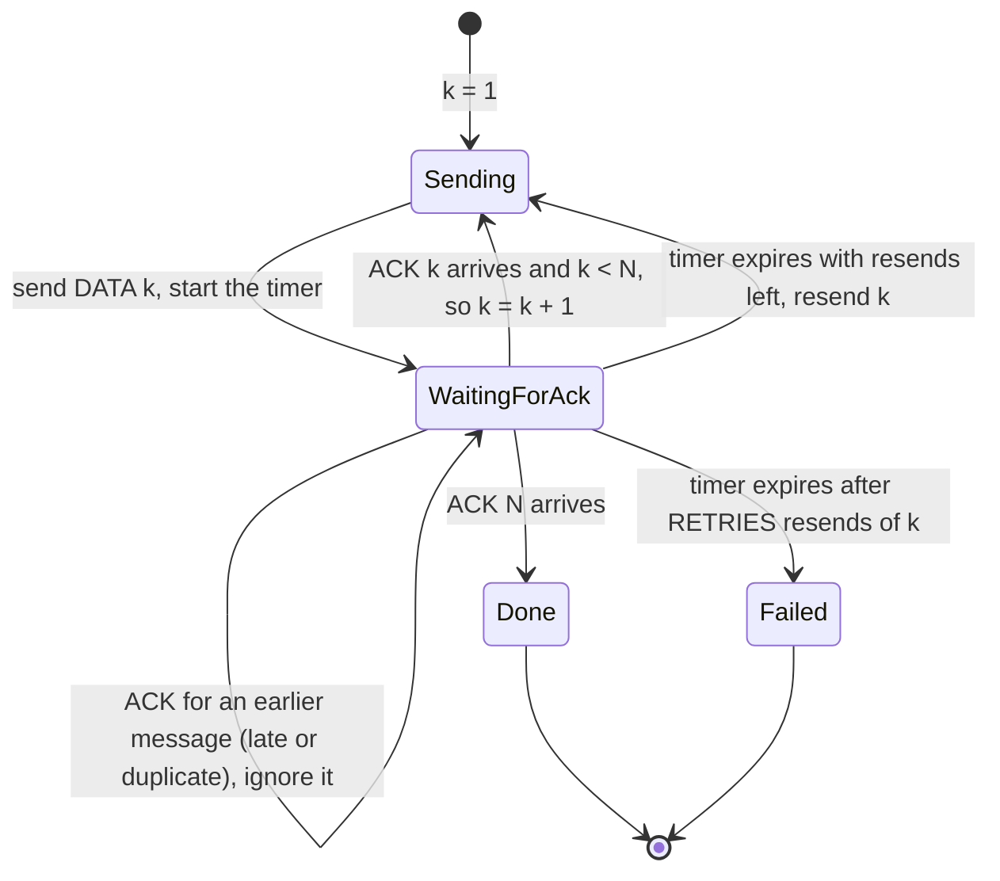
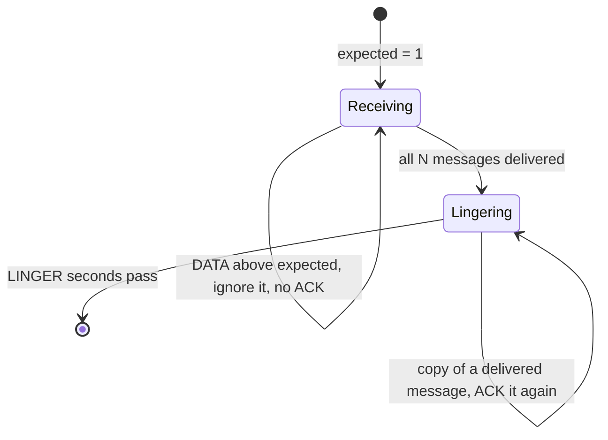
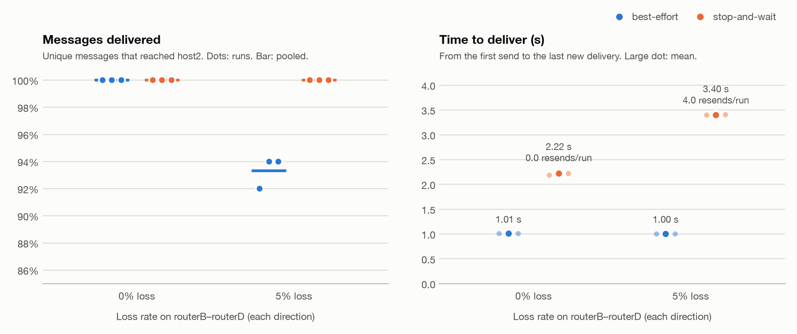
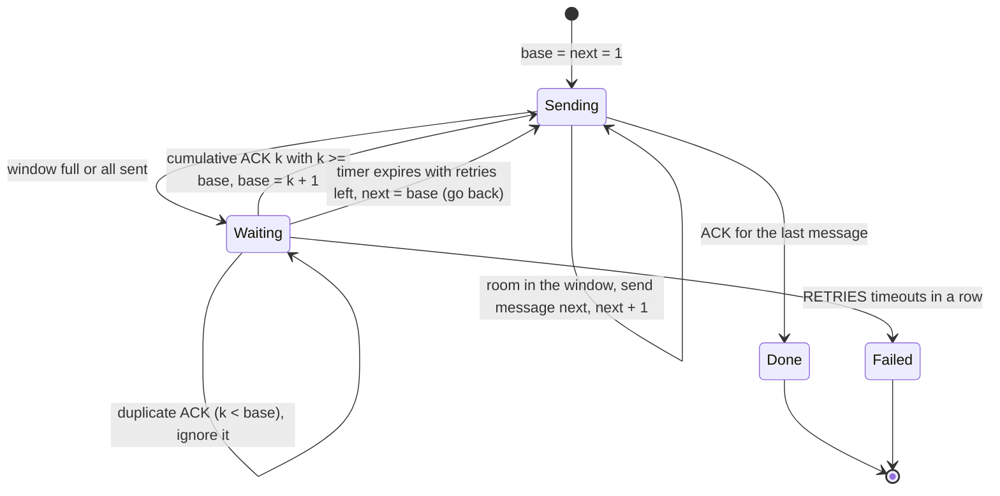
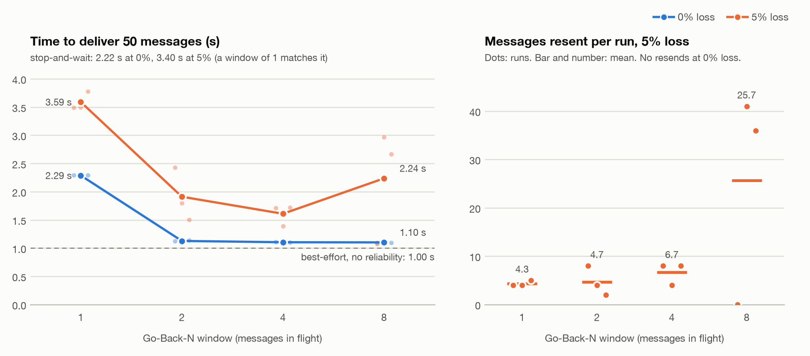

# Mini Internet Project

## Overview

A small virtual network built with Python 3 and UDP sockets: two hosts and four routers, each a separate process with a virtual address and its own UDP port. Hosts send packets through the routers, which forward them using static forwarding tables.

For the extension we chose **Track B, reliable transfer with stop-and-wait** (see [Track B](#track-b-reliable-transfer)). As the optional enhancement, we added a **Go-Back-N sliding window** (see [Enhancement](#enhancement-go-back-n-sliding-window)).

## Quick Start

Requires Python 3.10 or newer. Tested on macOS with Python 3.13.7, pytest 9.2.0 and matplotlib 3.11.2. Everything runs on localhost, so no network connection is needed after setup.

### 1. Get the code

```bash
git clone https://github.com/ShingiraiBhengesa/eps-mini-internet.git
cd eps-mini-internet
```

Already cloned? Run `git switch main` and `git pull` inside the folder instead.

### 2. One-time setup

Create a virtual environment and install the two packages the project uses, `pytest` and `matplotlib`:

```bash
python3 -m venv .venv
source .venv/bin/activate
python -m pip install -r requirements.txt
```

On Windows, activate with `.venv\Scripts\activate`.

### 3. In every new terminal

Every command in this README runs **from the project folder** with the **virtual environment active**. A new terminal starts outside both, so first run:

```bash
cd ~/eps-mini-internet
source .venv/bin/activate
```

Use your own path in the `cd` line if you cloned elsewhere. Your prompt now starts with `(.venv)`.

### 4. Check that everything works

```bash
python -m pytest -q
```

Expected: `221 passed` in a few seconds.

### 5. Watch the network run

Open two terminals and do step 3 in both.

**Terminal 1** starts the four routers and host2 and shows every event live. Leave it running:

```bash
python -m scripts.demo_net --run-id demo --replace
```

**Terminal 2** sends three probes from host1 to host2:

```bash
python -m src.host --name host1 --probe host2 --count 3 --run-id demo
```

Terminal 2 prints `3/3 probes answered`. Terminal 1 shows each probe crossing three routers and the echo coming back:

```text
14:49:33.678  host1    sends PROBE host1→host2 to routerA (hop limit 16)  [host1-3622e93a-1]
14:49:33.678  routerA  forwards PROBE host1→host2 to routerB, hop limit now 15  [host1-3622e93a-1]
14:49:33.679  routerB  forwards PROBE host1→host2 to routerD, hop limit now 14  [host1-3622e93a-1]
14:49:33.679  routerD  forwards PROBE host1→host2 to host2, hop limit now 13  [host1-3622e93a-1]
14:49:33.679  host2    sends ECHO host2→host1 to routerD (hop limit 16)  [host1-3622e93a-1]
14:49:33.679  routerD  forwards ECHO host2→host1 to routerB, hop limit now 15  [host1-3622e93a-1]
14:49:33.679  routerB  forwards ECHO host2→host1 to routerA, hop limit now 14  [host1-3622e93a-1]
14:49:33.679  routerA  forwards ECHO host2→host1 to host1, hop limit now 13  [host1-3622e93a-1]
14:49:33.680  host1    gets the ECHO back: round trip 1.5 ms  [host1-3622e93a-1]
```

Your times and IDs will differ. To follow probe 2 hop by hop, run `python -m scripts.trace logs/demo 2` in terminal 2.

### 6. Stop

Press **Ctrl-C in terminal 1**. It stops every router and host2. The logs stay in `logs/demo/`.

## Common Problems

| You see | Fix |
|---|---|
| `No module named 'scripts'` or `'src'` | Run the two lines from [step 3](#3-in-every-new-terminal) in that terminal. |
| `No module named 'pytest'` or `'matplotlib'` | Activate the environment (`source .venv/bin/activate`), or do [step 2](#2-one-time-setup). |
| `exited with code 2 before starting`, or `Address already in use` | An old router or host is still running. Stop it with `pkill -f "src.(router|host|reliable)"`. |
| `... already exists; pick another --run-id or add --replace` | Add `--replace`, or pick a new `--run-id`. |
| `... already exists; delete ... to rerun` | An experiment's output folder already has results. Pass a new `--out` folder. |
| Terminal 2 gets answers, but terminal 1 shows nothing | Both terminals must use the same `--run-id`. |
| `0/3 probes answered` | Start terminal 1 first and wait for its `started` lines. |

## Running the Network

### Live view (two terminals)

`scripts.demo_net` starts the four routers and host2 from one terminal and prints a readable line for every event, including host1's when host1 uses the same `--run-id`.

| Option | Effect |
|---|---|
| `--run-id NAME` | Name of the run; logs go to `logs/NAME/`. Default `demo`. |
| `--replace` | Delete an earlier run's logs with the same name first. |
| `--config FILE` | Topology to use. Default `config/topology_upper.json` (through routerB both ways). |
| `--link A-B --loss RATE --delay-ms MS` | Add loss (0 to 1) and one-way delay to one link. |
| `--drop-rule ROUTER:RULE` | Make one router drop chosen packets ([forced drop rules](#forced-drop-rules)). |
| `--seed N` | Seed for random loss; router i gets `N × 10 + i`. Default 0. |
| `--all` | Also show each router's receive, queue and send steps. |

### Tracing one packet

`python -m scripts.trace logs/demo` lists every probe in a run and how it ended. `python -m scripts.trace logs/demo 2` follows probe 2 hop by hop with timings, ending at the router that dropped it if it was lost. It works on any run folder, including those under `results/`.

### By hand (six terminals)

Each device can also run on its own. Run one command per terminal, routers and host2 first:

```bash
python -m src.router --name routerA --config config/topology_upper.json
python -m src.router --name routerB --config config/topology_upper.json
python -m src.router --name routerC --config config/topology_upper.json
python -m src.router --name routerD --config config/topology_upper.json
python -m src.host --name host2 --config config/topology_upper.json
python -m src.host --name host1 --probe host2 --count 3 --timeout 2 --config config/topology_upper.json
```

Each process prints its events as JSON lines; stop each with Ctrl-C. The probing host exits on its own, with exit code 0 only if every probe was answered. Add the same `--run-id` to every command to group the logs in one folder.

## Demo Scenarios

`python -m scripts.run_acceptance --out results/manual/acceptance` runs and checks all 10 core acceptance scenarios automatically in about 25 seconds. The committed run, with its commands and traces, is in [`results/acceptance/README.md`](results/acceptance/README.md).

To show them live, use the [live view](#live-view-two-terminals). The multihop exchange is [Quick Start step 5](#5-watch-the-network-run). For the others below, start terminal 1 with the command given (Ctrl-C first if it's already running), then run the terminal 2 command. Times and IDs will differ.

### Unknown destination

With the `demo` network running, probe routerB, which no router has a forwarding entry for:

```bash
python -m src.host --name host1 --probe routerB --timeout 1 --run-id demo
```

```text
14:44:47.868  routerA  DROPS PROBE host1→routerB: unknown_destination  [host1-bf3f30cc-1]
14:44:48.869  host1    TIMEOUT: no echo within 1.0 s  [host1-bf3f30cc-1]
```

### Invalid packet

With the `demo` network running, send bytes that aren't a packet to routerA's port:

```bash
python -c "import socket; socket.socket(socket.AF_INET, socket.SOCK_DGRAM).sendto(b'not a packet', ('127.0.0.1', 5101))"
```

```text
14:44:48.914  routerA  DROPS a malformed packet: Invalid JSON packet
```

routerA keeps running.

### Loss and delay on one link

**Terminal 1:** 80 ms delay each way and 30% loss on routerB–routerD.

```bash
python -m scripts.demo_net --run-id lossy --replace --link routerB-routerD --delay-ms 80 --loss 0.3 --seed 4
```

**Terminal 2:**

```bash
python -m src.host --name host1 --probe host2 --count 4 --interval 0.3 --timeout 1 --run-id lossy
```

```text
14:44:50.731  host1    gets the ECHO back: round trip 165.8 ms  [host1-9956f28f-1]
14:44:51.036  routerB  DROPS PROBE on the link to routerD (random loss 30%)  [host1-9956f28f-2]
14:44:52.037  host1    TIMEOUT: no echo within 1.0 s  [host1-9956f28f-2]
```

The round trip is about twice the delay. With seed 4, probe 2 is the one lost every time.

### Forced drop of one packet

**Terminal 1:** routerB drops the second probe, once.

```bash
python -m scripts.demo_net --run-id forced --replace --drop-rule "routerB:type=PROBE,skip=1"
```

**Terminal 2:**

```bash
python -m src.host --name host1 --probe host2 --count 3 --interval 0.3 --timeout 1 --run-id forced
```

```text
14:44:54.599  routerB  DROPS PROBE on the link to routerD (forced rule type=PROBE,skip=1,count=1)  [host1-cd63d51e-2]
14:44:55.600  host1    TIMEOUT: no echo within 1.0 s  [host1-cd63d51e-2]
```

Terminal 2 prints `2/3 probes answered`.

### Forwarding loop

**Terminal 1:** the loop config, where routerA and routerB send packets for routerD to each other.

```bash
python -m scripts.demo_net --run-id loop --replace --config config/topology_loop.json
```

**Terminal 2:**

```bash
python -m src.host --name host1 --probe routerD --hop-limit 6 --timeout 1 --run-id loop
```

```text
14:43:29.175  routerA  forwards PROBE host1→routerD to routerB, hop limit now 5
14:43:29.175  routerB  forwards PROBE host1→routerD to routerA, hop limit now 4
...
14:43:29.176  routerA  forwards PROBE host1→routerD to routerB, hop limit now 1
14:43:29.176  routerB  DROPS PROBE host1→routerD: hop_limit_exhausted
```

The probe bounces until its hop limit runs out. Traffic between the hosts is still routed normally in this config.

### Reliable transfer (Track B)

**Terminal 1:** routerB drops DATA message 3 once. The transfer ID `demo1` makes the message IDs `sw-demo1-1` to `sw-demo1-5`.

```bash
python -m scripts.demo_net --run-id track-b --replace --drop-rule "routerB:type=DATA,message_id=sw-demo1-3"
```

**Terminal 2:**

```bash
python -m src.reliable send --name host1 --to host2 --count 5 --transfer-id demo1 --run-id track-b
```

```text
16:16:33.926  routerB  DROPS DATA #3 on the link to routerD (forced rule type=DATA,message_id=sw-demo1-3,skip=0,count=1)  [sw-demo1-3]
16:16:34.427  host1    TIMEOUT: no ACK for #3 within 0.5 s  [sw-demo1-3]
16:16:34.427  host1    RESENDS DATA #3 (attempt 2)  [sw-demo1-3]
16:16:34.429  host2    delivers DATA #3 to the application  [sw-demo1-3]
16:16:34.430  host1    gets the ACK for #3 after 3.1 ms  [sw-demo1-3]
16:16:34.531  host1    done: 5/5 acknowledged, 1 resend, 0.71 s
```

`python -m scripts.trace logs/track-b 3` shows message 3's two attempts as separate paths.

## Packet Format

A packet is one JSON object, UTF-8 encoded, with exactly these six fields. Missing, extra or repeated fields are rejected.

| Field | Type and limits | Description |
|---|---|---|
| `src` | nonempty string, at most 32 characters | Virtual source address |
| `dst` | nonempty string, at most 32 characters | Virtual destination address |
| `hop_limit` | integer from 0 to 255 | Remaining hops (see [Forwarding](#forwarding)) |
| `type` | `PROBE`, `ECHO`, `DATA` or `ACK` | Message type |
| `message_id` | nonempty string, at most 64 characters | Matches a response to its request |
| `payload` | string | Message content |

An encoded packet is at most 1,200 bytes. `src/packet.py` validates every packet on send and on receive. Probe IDs look like `host1-3a3e3393-2` (host, random session, probe number), so a late echo from an earlier run can't match a new probe. An `ECHO` reuses its probe's `message_id` and `payload`, and host1 accepts it only if the ID, sender and payload all match.

## Forwarding

A router handles each packet in this order. The first check that fails drops the packet and logs a `drop` event with the reason:

1. The packet must decode and validate: `malformed_packet`.
2. It must come from a configured neighbor's UDP endpoint: `unconfigured_sender`.
3. Its incoming `hop_limit` must be above 1: `hop_limit_exhausted`. The router then subtracts one.
4. The destination must be in the forwarding table: `unknown_destination`.
5. The next hop must be a neighbor: `invalid_next_hop`.

Hosts send with `hop_limit` 16 by default (`--hop-limit` changes it), so a probe reaches host2 with 13.

## Network Conditions

Each link has a loss rate (`loss`, 0 to 1) and a one-way delay (`delay_ms`), used in both directions. The router sending on a link applies, in order:

1. **Forced drop rules**, logged as `drop_forced`.
2. **Random loss** from the router's own seeded generator, logged as `drop_injected`.
3. **Delay**, in a queue that doesn't block the router's other packets.

Hosts send straight to their gateway, so host1→routerA and host2→routerD are never lossy or delayed. The committed configs have no loss or delay; the live view and the experiments set them on one link at run time.

### Forced drop rules

A rule drops chosen packets a fixed number of times, so a test can lose one specific packet:

```bash
python -m src.router --name routerB --drop-rule "type=PROBE,skip=1"
```

A rule matches on any of `message_id`, `type`, `src`, `dst` and `next_hop`. `skip=N` lets the first N matches through and `count=N` drops the next N (default 1); later matches go through, so a retransmission is delivered. The live view and the launcher take the rule prefixed with a router name, such as `routerB:type=PROBE,skip=1`.

## Logging

Every device writes one JSON object per event to the terminal and to `logs/<run-id>/<device>.jsonl` (`--run-id`, default `default`; `--log-dir` changes `logs`). Every record has `run_id`, `device`, `timestamp` and `event`, plus the packet's `message_id`, `type`, `src`, `dst` and `hop_limit` when it concerns a packet. The first record, `started`, holds the device's settings: endpoint, and for routers the seed, link conditions and drop rules.

| Event | Device | Meaning |
|---|---|---|
| `started` | all | Process is ready, with its settings |
| `sent`, `received` | all | A packet left or arrived |
| `forward`, `send_scheduled` | router | Forwarding decision; packet queued for its link delay |
| `drop` | router | A forwarding check failed; `reason` says which |
| `drop_injected`, `drop_forced` | router | Random loss, or a matching drop rule (`rule`) |
| `echo_received` | host | Matching echo, with `rtt_ms` |
| `probe_timeout` | host | No matching echo within `--timeout` |
| `echo_payload_mismatch`, `dropped_unexpected_echo` | host | Echo with the wrong payload, or for another probe; not counted |

`logs/` is ignored by git; experiment logs go to `results/` and are committed.

## Configuration

```text
          +-- routerB --+
host1 -- routerA        routerD -- host2
          +-- routerC --+
```

host1 is UDP port 5001, host2 5002, and routerA to routerD 5101 to 5104, all on 127.0.0.1. Each device in a config has a virtual address, endpoint and neighbors; routers also have a forwarding table. The `paths` section lists the expected host-to-host routes, and the validator rejects a config whose tables don't produce them, including loops.

| File | Routes |
|---|---|
| `config/topology.json` | host1→host2 through routerB, replies through routerC |
| `config/topology_upper.json` | routerB in both directions (the default) |
| `config/topology_lower.json` | routerC in both directions |
| `config/topology_loop.json` | as `topology.json`, plus a forwarding loop for packets addressed to routerD |

`python -m scripts.make_routes` generates the last three from `config/topology.json`.

## Experiments

### Tools

Each experiment script refuses to overwrite an existing results folder. The commands in this README write to `results/manual/`, which git ignores, so the committed results stay unchanged.

| Command | What it does |
|---|---|
| `python -m scripts.run_acceptance --out DIR` | Runs and checks every core acceptance scenario |
| `python -m scripts.launch ...` | One run: starts the routers and host2, runs host1's probes, stops everything |
| `python -m scripts.run_baseline --out DIR` | The baseline matrix (12 runs) |
| `python -m scripts.run_trackb evidence --out DIR` | Track B's four fixed cases, each checked automatically |
| `python -m scripts.run_trackb compare --out DIR` | Best-effort vs stop-and-wait (12 runs) |
| `python -m scripts.run_trackb evidence --mode gobackn --out DIR` | Go-Back-N's five fixed cases |
| `python -m scripts.run_trackb window --out DIR` | Go-Back-N at windows 1, 2, 4 and 8 (24 runs) |
| `python -m scripts.plot_results DIR`, `plot_trackb DIR`, `plot_window DIR` | Draw `baseline.png`, `trackb.png`, `window.png` |
| `python -m scripts.metrics DIR` | Recompute `runs.csv` and `conditions.csv` from a folder's logs |

Every run folder holds each device's log, `config.json` (the exact topology used) and `run.json` (seeds, parameters, the sender's result and the code commit). The same seeds lose the same packets. A single run looks like this:

```bash
python -m scripts.launch --run-id demo-1 --seed 1 --link routerB-routerD --loss 0.05 --delay-ms 20 --count 20
```

### Baseline

```bash
python -m scripts.run_baseline --out results/manual/baseline
python -m scripts.plot_results results/manual/baseline
```

**Setup** (about 1.5 minutes). Upper path, so probes and echoes both cross **routerB–routerD**, the only link with loss or delay. One-way delay 20 or 80 ms × loss 0% or 5%, 3 runs per condition, seeds 1 to 12, 20 probes per run, one every 0.2 s, 1 s timeout.

**Results** (`results/baseline/`):

| Condition | Answered | Success (± SD across runs) | RTT mean ± SD | RTT median | Timeouts |
|---|---|---|---|---|---|
| 20 ms, 0% loss | 60/60 | 100.0% (± 0.0) | 58.4 ± 95.1 ms | 46.2 ms | 0 |
| 20 ms, 5% loss | 56/60 | 93.3% (± 2.9) | 45.8 ± 2.3 ms | 45.7 ms | 4 |
| 80 ms, 0% loss | 60/60 | 100.0% (± 0.0) | 166.5 ± 4.7 ms | 165.9 ms | 0 |
| 80 ms, 5% loss | 52/60 | 86.7% (± 10.4) | 166.2 ± 1.5 ms | 166.4 ms | 8 |



- **Round trip ≈ 2 × delay + 6 ms**, the 6 ms being six router hops in Python.
- **Loss hits both directions**, so a probe survives with probability 0.95² ≈ 90.25%. 108 of the 120 lossy probes succeeded (90.0%); the 93.3% vs 86.7% gap is 20-probe sampling noise.
- **Every timeout matches one logged drop.** One 782 ms probe came from the computer pausing routerA for 470 ms. It is kept, which is why that condition's median, not its mean, shows the typical value.

## Wireshark Evidence

[`results/wireshark/README.md`](results/wireshark/README.md) has the two captures (a probe and its echo hop by hop, and a Track B retransmission), how to take them, and a write-up matching each frame to a log line.

## Testing

```bash
python -m pytest -q
```

221 tests cover packets, configs, UDP, hosts, routers, hop limits, loss, delay and drop rules, logging, the launcher, metrics, the live view, the trace, Track B and Go-Back-N, including full transfers through real routers with forced drops.

## Module Interfaces

- `src/packet.py`: Encodes, decodes and validates packets.
- `src/config.py`: Loads and validates the network configuration.
- `src/transport.py`: Sends and receives packets over UDP.
- `src/host.py`: Sends probes, answers with echoes, handles timeouts, and receives Track B transfers.
- `src/router.py`: Forwards packets using static forwarding tables.
- `src/forwarding_checks.py`: Checks hop limits, destinations and next hops.
- `src/conditions.py`: Applies loss, delay and forced drop rules on outgoing links.
- `src/run_log.py`: Records events as JSON lines, to the terminal and per-device files.
- `src/shutdown.py`: Stops a process cleanly on Ctrl-C or SIGTERM.
- `src/reliable.py`: Track B: the stop-and-wait, best-effort and Go-Back-N senders, the receiver, and their command line.
- `scripts/make_routes.py`: Generates the upper, lower and loop configs.
- `scripts/launch.py`, `scripts/run_baseline.py`, `scripts/run_acceptance.py`, `scripts/metrics.py`, `scripts/plot_results.py`: Experiment tools.
- `scripts/demo_net.py`, `scripts/trace.py`: Live view and packet tracing.
- `scripts/run_trackb.py`, `scripts/plot_trackb.py`, `scripts/plot_window.py`: Track B and Go-Back-N runs and charts.

## Track B: Reliable Transfer

Stop-and-wait delivery on top of the network, plus a best-effort sender to compare it with, in `src/reliable.py`. The packet format doesn't change.

### Message IDs

The sequence number is part of the message ID, `<mode>-<transfer>-<n>`: mode `sw` (stop-and-wait), `be` (best-effort) or `gbn` (Go-Back-N); a transfer name (random, or `--transfer-id`); and the message number. For example, `sw-demo1-3` is message 3 of transfer `demo1`. An ACK carries the ID of the DATA it acknowledges. DATA payloads are `data-0001`, `data-0002`, and so on. Predictable IDs let a drop rule target one message, such as `type=ACK,message_id=sw-demo1-5`.

### Sender



- It sends message k and waits up to `--timeout` seconds for its ACK, resending on timeout. After `--retries` resends of one message it gives up (exit code 1).
- Late, duplicate and other transfers' ACKs are logged and ignored.
- It never sends faster than `--rate` messages per second, resends included.

### Receiver



- Only the next expected message is delivered, so each message is delivered exactly once and in order. A copy of a delivered message is ACKed again, since its first ACK may have been lost.
- With `--expect N`, the receiver keeps answering for `--linger` seconds after the last message, so a resent final message still gets its ACK. LINGER must exceed RETRIES × TIMEOUT (defaults: 3 s against 2.5 s).
- In best-effort mode the receiver delivers each new message once, in any order, and sends no ACKs.

### Commands

The live view's host2 already receives transfers, so with `scripts.demo_net` running, only the sender is needed. To run by hand, start the four routers, then use the receiver in place of host2:

```bash
python -m src.reliable receive --name host2 --expect 20
python -m src.reliable send --name host1 --to host2 --count 20
```

| Option | Default | Meaning |
|---|---|---|
| `send --mode` | `stopwait` | `stopwait`, `besteffort` or `gobackn` |
| `send --window` | 4 | Go-Back-N only: most messages in flight |
| `send --count` | 20 | Number of messages |
| `send --rate` | 20 | Most messages sent per second |
| `send --timeout` | 0.5 | Seconds to wait for an ACK |
| `send --retries` | 5 | Resends allowed per message before giving up |
| `send --transfer-id` | random | Name used in the message IDs |
| `receive --expect` | none | Messages in the transfer; turns on the waiting time |
| `receive --linger` | 3 | Seconds to keep answering after the last message |
| `receive --observe` | none | Stop this many seconds after the first message |

Both also take `--config`, `--run-id` and `--log-dir`. They log `transfer_started`, `transfer_done`, `transfer_failed`, `retransmit`, `ack_received`, `ack_timeout` and `ack_ignored` (sender), and `delivered`, `duplicate`, `dropped_out_of_order` and `receiver_done` (receiver).

### Required evidence

```bash
python -m scripts.run_trackb evidence --out results/manual/evidence
```

Four stop-and-wait transfers of 10 messages, each checked automatically (upper path, 20 ms delay, 0.3 s timeout, 5 retries). Committed results: `results/trackb/evidence/`.

| Case | What happened | Result |
|---|---|---|
| No loss | 10/10 delivered once and in order, no retransmissions, 0.49 s | PASS |
| DATA 5 dropped at routerB | Timed out after 0.3 s and resent. 10/10 in order, no duplicates, 0.80 s | PASS |
| Final ACK dropped at routerD | Message 10 resent; the waiting receiver didn't deliver it again but ACKed it again | PASS |
| host2 not running | Gave up on message 1 after 5 resends, in 1.81 s, exit code 1 | PASS |

### Comparison with best-effort

```bash
python -m scripts.run_trackb compare --out results/manual/compare
python -m scripts.plot_trackb results/manual/compare
```

**Setup** (about 50 seconds). Upper path, 20 ms delay and 0% or 5% loss on routerB–routerD, so DATA and ACKs both cross the lossy link. 50 messages at most 50 per second, 0.3 s timeout, 5 retries, 3 runs per condition, seeds 101 to 112. Time to deliver runs until host2 delivers the last new message.

**Results** (`results/trackb/compare/`):

| Condition | Delivered | Full sequence | Resends per run | Time to deliver (mean ± SD) |
|---|---|---|---|---|
| Best-effort, 0% loss | 150/150 | 3 of 3 runs | 0 | 1.01 ± 0.00 s |
| Stop-and-wait, 0% loss | 150/150 | 3 of 3 runs | 0 | 2.22 ± 0.03 s |
| Best-effort, 5% loss | 140/150 | 0 of 3 runs | 0 | 1.00 ± 0.00 s |
| Stop-and-wait, 5% loss | 150/150 | 3 of 3 runs | 4.0 | 3.40 ± 0.01 s |



- **Reliability.** Stop-and-wait delivered every message once and in order; at 5% loss, best-effort lost 10 of 150 for good.
- **Cost without loss: 2.2×.** Stop-and-wait waits one round trip (about 44 ms) per message, while best-effort sends every 20 ms.
- **Cost with loss: 3.4×.** Each lost DATA or ACK costs a 0.3 s timeout. Every lossy run lost 4 packets (at different messages), so 2.2 + 4 × 0.3 ≈ 3.4 s.
- **Duplicates come from lost ACKs:** 3 of the 12 losses were ACKs, and each time the receiver ACKed the repeat without delivering it twice.

### Limitations

- If every ACK for the final message is lost, the sender reports failure although the receiver has everything. The waiting time makes this unlikely, not impossible.
- One message per round trip, so most time on a long link is spent waiting.
- The timeout is fixed, not adapted to the measured round trip.

## Enhancement: Go-Back-N Sliding Window

The optional enhancement: a sender that keeps up to N messages in flight. It is a separate mode, `--mode gobackn`, so stop-and-wait and its results are unchanged.

### How it works

- **Sender.** It sends while fewer than `--window` messages are unacknowledged, reading ACKs between sends. One timer runs for the oldest unacknowledged message, the *base*.
- **Cumulative ACKs.** The receiver still delivers only the next expected message, and its ACK for k means 1 to k have all arrived, so a later ACK covers a lost earlier one. A message after a gap is discarded and the last in-order message is re-ACKed.
- **Going back.** When the base's timer expires, the sender resends everything from the base. After `--retries` timeouts in a row without progress, it gives up.



To see it live, start terminal 1 with `python -m scripts.demo_net --run-id gbn --replace --drop-rule "routerB:type=DATA,message_id=gbn-demo3-5"`, then in terminal 2:

```bash
python -m src.reliable send --name host1 --to host2 --mode gobackn --window 4 --count 10 --rate 100 --transfer-id demo3 --run-id gbn
```

```text
18:07:02.030  routerB  DROPS DATA #5 on the link to routerD (forced rule type=DATA,message_id=gbn-demo3-5,skip=0,count=1)  [gbn-demo3-5]
18:07:02.041  host2    discards DATA #6: waiting for #5, ACKs #4 again  [gbn-demo3-6]
18:07:02.531  host1    TIMEOUT: no ACK for #5 within 0.5 s; going back to resend 4 messages  [gbn-demo3-5]
18:07:02.590  host1    done: 10/10 acknowledged, 4 resends, 0.61 s
```

### Evidence

```bash
python -m scripts.run_trackb evidence --mode gobackn --out results/manual/window-evidence
```

Five transfers of 10 messages with a window of 4, each checked automatically, at up to 100 messages per second so the window fills. Committed results: `results/trackb/window-evidence/`.

| Case | What happened | Result |
|---|---|---|
| No loss | 10/10 in order, no retransmissions, 4 in flight at the peak | PASS |
| DATA 5 dropped at routerB | The receiver discarded what followed the gap; the sender went back and resent the 4 in flight | PASS |
| ACK 3 dropped at routerD | The next cumulative ACK covered it; nothing resent | PASS |
| Final ACK dropped at routerD | Message 10 resent and ACKed again by the waiting receiver | PASS |
| host2 not running | Resent the window of 4 five times (20 resends), then gave up, in 1.81 s | PASS |

### Comparison with stop-and-wait and best-effort

```bash
python -m scripts.run_trackb window --out results/manual/window
python -m scripts.plot_window results/manual/window
```

**Setup** (about 1.5 minutes). The Track B comparison's settings, with windows of 1, 2, 4 and 8, 3 runs each, seeds 201 to 224. Every run delivered all 50 messages in order.

**Results** (`results/trackb/window/`):

| Window | Time, 0% loss | Time, 5% loss | Resends per run, 5% loss |
|---|---|---|---|
| 1 | 2.29 ± 0.01 s | 3.59 ± 0.16 s | 4.3 |
| 2 | 1.13 ± 0.01 s | 1.91 ± 0.47 s | 4.7 |
| 4 | 1.10 ± 0.00 s | 1.61 ± 0.19 s | 6.7 |
| 8 | 1.10 ± 0.01 s | 2.24 ± 1.02 s | 25.7 |



- **Window 1 behaves like stop-and-wait** (2.29 s and 3.59 s against 2.22 s and 3.40 s), a check on the implementation.
- **The gain stops at about 3 in flight.** A 44 ms round trip at one send per 20 ms holds about 2.2 messages (the bandwidth-delay product), so windows 4 and 8 come within 10% of best-effort's 1.00 s.
- **Window 4 is fastest under loss** (1.61 s, under half of stop-and-wait's 3.40 s), since lost ACKs are covered by later ones.
- **Larger windows waste resends.** A window of 8 lets 8 messages pile up behind a lost one, and going back resends them all across the lossy link.

### Limitations

- One loss resends the whole window; Selective Repeat would resend only the lost message.
- The timeout is fixed, and the window is a fixed sender setting with no flow control from the receiver.
- With 3 runs per condition, results under loss vary widely, especially at window 8.
