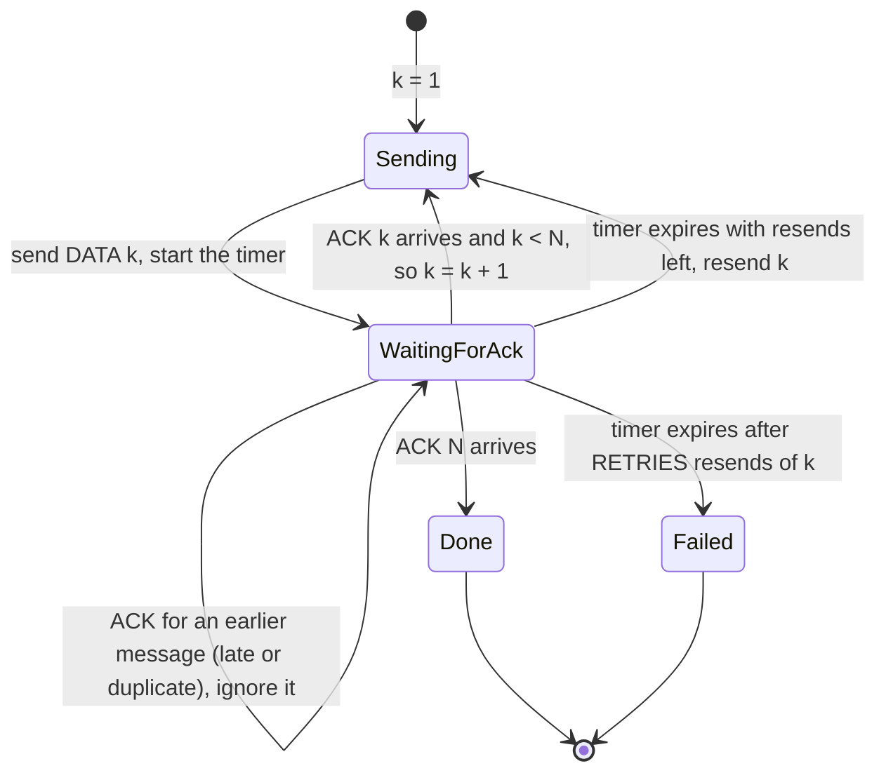
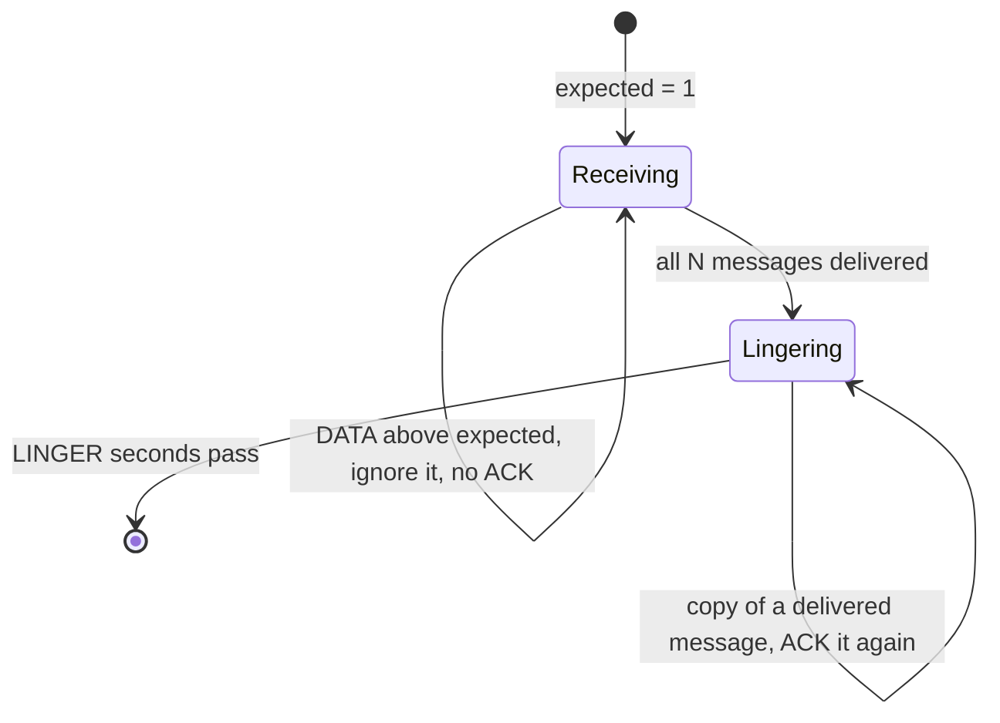
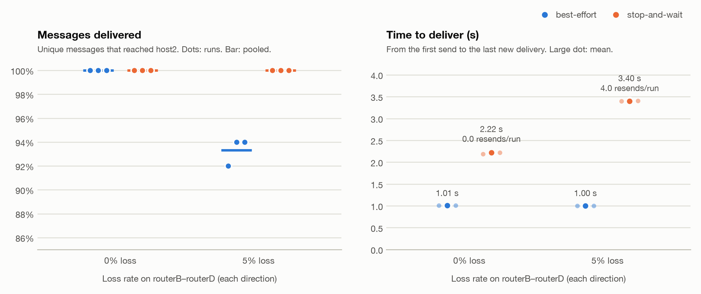

# eps-mini-internet
# Mini Internet Project

## Overview

This project uses Python 3 and UDP sockets to create a small virtual network with two hosts and four routers. Each device has a virtual address and a UDP endpoint. Hosts communicate by sending packets through routers, which use static forwarding tables to determine where to send packets next.

For the extension, we chose Track B: reliable transfer using a stop-and-wait protocol (see [Track B](#track-b-reliable-transfer)).

## Quick Start

Requires Python 3.10 or newer. Developed and tested on Python 3.13 on macOS. Everything runs on your own computer over localhost, so no network connection is needed after setup.

### 1. Get the code

First time:

```bash
git clone https://github.com/ShingiraiBhengesa/eps-mini-internet.git
cd eps-mini-internet
```

Already cloned? Update it:

```bash
cd eps-mini-internet
git switch main
git pull
```

### 2. One-time setup

From inside the `eps-mini-internet` folder, create a virtual environment and install the two packages the project uses, `pytest` for tests and `matplotlib` for plots:

```bash
python3 -m venv .venv
source .venv/bin/activate
python -m pip install -r requirements.txt
```

On Windows, activate with `.venv\Scripts\activate` instead of `source .venv/bin/activate`.

### 3. In every new terminal

Every command in this README must run **from the project folder** with the **virtual environment active**. Each new terminal window or tab starts outside both, so first run:

```bash
cd ~/eps-mini-internet
source .venv/bin/activate
```

If you cloned the project somewhere other than your home folder, use that path in the `cd` line. Your prompt now starts with `(.venv)`. If you use conda and your prompt also shows `(base)`, that's fine: once `.venv` is active, `python` uses the project's environment.

If you see `No module named 'scripts'` or `No module named 'src'`, you skipped this step: you're in the wrong folder, or the environment isn't active.

### 4. Check that everything works

```bash
python -m pytest -q
```

Expected: `203 passed` in a few seconds.

### 5. Watch the network run

Open two terminals and do step 3 in both.

**Terminal 1** starts the four routers and host2, then shows every event as it happens. Leave it running:

```bash
python -m scripts.demo_net --run-id demo --replace
```

**Terminal 2** sends three probes from host1 to host2:

```bash
python -m src.host --name host1 --probe host2 --count 3 --run-id demo
```

Terminal 2 prints `3/3 probes answered`. Terminal 1 shows each probe crossing the network and the echo coming back:

```text
14:49:33.678  host1    sends PROBE host1→host2 to routerA (hop limit 16)  [host1-3622e93a-1]
14:49:33.678  routerA  forwards PROBE host1→host2 to routerB, hop limit now 15  [host1-3622e93a-1]
14:49:33.679  routerB  forwards PROBE host1→host2 to routerD, hop limit now 14  [host1-3622e93a-1]
14:49:33.679  routerD  forwards PROBE host1→host2 to host2, hop limit now 13  [host1-3622e93a-1]
14:49:33.679  host2    sends ECHO host2→host1 to routerD (hop limit 16)  [host1-3622e93a-1]
14:49:33.679  routerD  forwards ECHO host2→host1 to routerB, hop limit now 15  [host1-3622e93a-1]
14:49:33.679  routerB  forwards ECHO host2→host1 to routerA, hop limit now 14  [host1-3622e93a-1]
14:49:33.679  routerA  forwards ECHO host2→host1 to host1, hop limit now 13  [host1-3622e93a-1]
14:49:33.680  host1    gets the ECHO back: round trip 1.5 ms  [host1-3622e93a-1]
```

Your times and IDs will differ. Then follow one probe hop by hop, still in terminal 2:

```bash
python -m scripts.trace logs/demo 2
```

### 6. Stop

Press **Ctrl-C in terminal 1**. It stops every router and host2 and prints `Network stopped`. The logs stay in `logs/demo/`.

## Common Problems

| You see | Fix |
|---|---|
| `No module named 'scripts'` or `'src'` | Run the two lines from [step 3](#3-in-every-new-terminal) in that terminal. |
| `No module named 'pytest'` or `'matplotlib'` | The environment isn't active (`source .venv/bin/activate`), or setup was skipped ([step 2](#2-one-time-setup)). |
| `exited with code 2 before starting`, or `Address already in use` | An old router or host is still running. Stop it with `pkill -f "src.(router|host|reliable)"`, then try again. |
| `... already exists; pick another --run-id or add --replace` | That run ID was used before. Add `--replace`, or pick a new `--run-id`. |
| Terminal 2 prints answers, but terminal 1 shows nothing | Both terminals must use the same `--run-id`. |
| `0/3 probes answered` | The network isn't running. Start terminal 1 first and wait for its `started` lines. |

## Running the Network

### Live view (two terminals)

`scripts.demo_net` is the easiest way to run the network, as in [Quick Start](#5-watch-the-network-run). It starts the four routers and host2 from one terminal and prints readable lines for every device's events, including host1's when host1 uses the same `--run-id`.

| Option | Effect |
|---|---|
| `--run-id NAME` | Name of the run; logs go to `logs/NAME/`. Default `demo`. |
| `--replace` | Delete an earlier run's logs with the same name first. |
| `--config FILE` | Topology to use. Default `config/topology_upper.json` (through routerB both ways). |
| `--link A-B --loss RATE --delay-ms MS` | Add loss (0 to 1) and one-way delay to one link. |
| `--drop-rule ROUTER:RULE` | Make one router drop chosen packets ([forced drop rules](#forced-drop-rules)). |
| `--seed N` | Seed for random loss; router i gets `N × 10 + i`. Default 0. |
| `--all` | Also show each router's receive, queue and send steps. |

host1 only needs its own address and gateway, which every config file shares, so terminal 2 doesn't need `--config`.

### Tracing one packet

List every probe in a run and how it ended:

```bash
python -m scripts.trace logs/demo
```

Follow probe 2 hop by hop, with timings:

```bash
python -m scripts.trace logs/demo 2
```

The trace lists each step with its time since the probe was sent, then the whole path, for example `host1 → routerA → routerB → routerD → host2 → routerD → routerB → routerA → host1`. A lost packet ends at the router that dropped it, with the reason. It works on any run folder, including those under `results/`.

### By hand (six terminals)

Each device can also be started on its own. Do [step 3](#3-in-every-new-terminal) in each terminal, then run one command per terminal, routers and host2 first:

```bash
python -m src.router --name routerA --config config/topology_upper.json
python -m src.router --name routerB --config config/topology_upper.json
python -m src.router --name routerC --config config/topology_upper.json
python -m src.router --name routerD --config config/topology_upper.json
python -m src.host --name host2 --config config/topology_upper.json
python -m src.host --name host1 --probe host2 --count 3 --timeout 2 --config config/topology_upper.json
```

Each process prints its own events as JSON lines. Stop the routers and host2 with Ctrl-C in each terminal. The probing host exits on its own and prints `N/M probes answered`. Its exit code is 0 only if every probe was answered. Add the same `--run-id` to every command to group the logs in one folder. For the lower path, use `config/topology_lower.json`. Host2 can also probe host1 by swapping the roles.

## Demo Scenarios

Recorded, automatically checked evidence for all of these scenarios is in [`results/acceptance/README.md`](results/acceptance/README.md); `python -m scripts.run_acceptance` regenerates it in about 25 seconds.

Each scenario uses the [live view](#live-view-two-terminals): a terminal 1 command that starts the network, and terminal 2 commands that send traffic. Scenarios with the same run ID share one network. For the others, press Ctrl-C in terminal 1 and start it again with the new command. Every output below was produced by running these commands. Times and IDs will differ.

### Probe and echo

**Terminal 1:**

```bash
python -m scripts.demo_net --run-id demo --replace
```

**Terminal 2:**

```bash
python -m src.host --name host1 --probe host2 --count 3 --run-id demo
```

The output is in [Quick Start](#5-watch-the-network-run). host2 answers each `PROBE` with an `ECHO` carrying the same message ID and payload. host1 accepts an echo only if the ID, the sender and the payload all match, then logs `echo_received` with `rtt_ms`. An echo whose payload differs is logged as `echo_payload_mismatch` and ignored. By default probes carry `probe-0001`, `probe-0002`, and so on (always 10 bytes). `--payload` sets a fixed payload instead.

### Unknown destination

With the `demo` network still running, probe routerB. It's a device in the config, but no router has a forwarding entry for it:

**Terminal 2:**

```bash
python -m src.host --name host1 --probe routerB --timeout 1 --run-id demo
```

```text
14:44:47.868  routerA  DROPS PROBE host1→routerB: unknown_destination  [host1-bf3f30cc-1]
14:44:48.869  host1    TIMEOUT: no echo within 1.0 s  [host1-bf3f30cc-1]
```

A name that isn't in the config at all, such as `hostZ`, is rejected by host1 before anything is sent.

### Invalid packet

With the `demo` network still running, send bytes that aren't a packet to routerA's port (5101):

**Terminal 2:**

```bash
python -c "import socket; socket.socket(socket.AF_INET, socket.SOCK_DGRAM).sendto(b'not a packet', ('127.0.0.1', 5101))"
```

```text
14:44:48.914  routerA  DROPS a malformed packet: Invalid JSON packet
```

routerA keeps running.

### Loss and delay on one link

Restart terminal 1 with 80 ms delay each way and 30% loss on routerB–routerD:

**Terminal 1:**

```bash
python -m scripts.demo_net --run-id lossy --replace --link routerB-routerD --delay-ms 80 --loss 0.3 --seed 4
```

**Terminal 2:**

```bash
python -m src.host --name host1 --probe host2 --count 4 --interval 0.3 --timeout 1 --run-id lossy
```

```text
14:44:50.731  host1    gets the ECHO back: round trip 165.8 ms  [host1-9956f28f-1]
14:44:51.036  routerB  DROPS PROBE on the link to routerD (random loss 30%)  [host1-9956f28f-2]
14:44:52.037  host1    TIMEOUT: no echo within 1.0 s  [host1-9956f28f-2]
14:44:52.505  host1    gets the ECHO back: round trip 166.6 ms  [host1-9956f28f-3]
14:44:52.977  host1    gets the ECHO back: round trip 166.4 ms  [host1-9956f28f-4]
```

The round trip is about twice the delay plus a few milliseconds. The 30% loss rate makes a drop likely within four probes. With seed 4 and these commands, probe 2 is the one lost every time.

### Forced drop of one packet

Restart terminal 1 with a rule that makes routerB drop the second probe, once:

**Terminal 1:**

```bash
python -m scripts.demo_net --run-id forced --replace --drop-rule "routerB:type=PROBE,skip=1"
```

**Terminal 2:**

```bash
python -m src.host --name host1 --probe host2 --count 3 --interval 0.3 --timeout 1 --run-id forced
```

```text
14:44:54.293  host1    gets the ECHO back: round trip 1.8 ms  [host1-cd63d51e-1]
14:44:54.599  routerB  DROPS PROBE on the link to routerD (forced rule type=PROBE,skip=1,count=1)  [host1-cd63d51e-2]
14:44:55.600  host1    TIMEOUT: no echo within 1.0 s  [host1-cd63d51e-2]
14:44:55.905  host1    gets the ECHO back: round trip 2.2 ms  [host1-cd63d51e-3]
```

Terminal 2 prints `2/3 probes answered`.

### Forwarding loop

Restart terminal 1 with the loop config, then send a probe to routerD with a small hop limit:

**Terminal 1:**

```bash
python -m scripts.demo_net --run-id loop --replace --config config/topology_loop.json
```

**Terminal 2:**

```bash
python -m src.host --name host1 --probe routerD --hop-limit 6 --timeout 1 --run-id loop
```

```text
14:43:29.175  host1    sends PROBE host1→routerD to routerA (hop limit 6)
14:43:29.175  routerA  forwards PROBE host1→routerD to routerB, hop limit now 5
14:43:29.175  routerB  forwards PROBE host1→routerD to routerA, hop limit now 4
14:43:29.176  routerA  forwards PROBE host1→routerD to routerB, hop limit now 3
14:43:29.176  routerB  forwards PROBE host1→routerD to routerA, hop limit now 2
14:43:29.176  routerA  forwards PROBE host1→routerD to routerB, hop limit now 1
14:43:29.176  routerB  DROPS PROBE host1→routerD: hop_limit_exhausted
14:43:30.176  host1    TIMEOUT: no echo within 1.0 s
```

In this config, routerA and routerB send packets for routerD to each other, so the probe bounces until its hop limit runs out. The validator rejects loops on the host1↔host2 routes in `paths`, so the loop uses routerD as the destination instead. Traffic between the hosts is routed normally in this config.

### Reliable transfer (Track B)

Restart terminal 1 with a rule that makes routerB drop DATA message 3 once. The transfer ID `demo1` makes the message IDs predictable (`sw-demo1-1` to `sw-demo1-5`):

**Terminal 1:**

```bash
python -m scripts.demo_net --run-id track-b --replace --drop-rule "routerB:type=DATA,message_id=sw-demo1-3"
```

**Terminal 2:**

```bash
python -m src.reliable send --name host1 --to host2 --count 5 --transfer-id demo1 --run-id track-b
```

```text
16:16:33.822  host1    starts a stop-and-wait transfer: 5 messages to host2, 0.5 s ACK timeout, up to 5 resends each
...
16:16:33.926  host1    sends DATA #3 host1→host2 to routerA (hop limit 16)  [sw-demo1-3]
16:16:33.926  routerA  forwards DATA #3 host1→host2 to routerB, hop limit now 15  [sw-demo1-3]
16:16:33.926  routerB  forwards DATA #3 host1→host2 to routerD, hop limit now 14  [sw-demo1-3]
16:16:33.926  routerB  DROPS DATA #3 on the link to routerD (forced rule type=DATA,message_id=sw-demo1-3,skip=0,count=1)  [sw-demo1-3]
16:16:34.427  host1    TIMEOUT: no ACK for #3 within 0.5 s  [sw-demo1-3]
16:16:34.427  host1    RESENDS DATA #3 (attempt 2)  [sw-demo1-3]
...
16:16:34.429  host2    delivers DATA #3 to the application  [sw-demo1-3]
16:16:34.429  host2    sends ACK #3 host2→host1 to routerD (hop limit 16)  [sw-demo1-3]
...
16:16:34.430  host1    gets the ACK for #3 after 3.1 ms  [sw-demo1-3]
...
16:16:34.531  host1    done: 5/5 acknowledged, 1 resend, 0.71 s
```

Terminal 2 prints `stop-and-wait: 5/5 messages acknowledged, 1 retransmission, 0.71 s`. Then `python -m scripts.trace logs/track-b 3` shows message 3's two attempts as separate paths. Every host in the live view already receives Track B transfers, so host2 needs no extra command. See [Track B](#track-b-reliable-transfer) for how the protocol works.

## Packet Format

Packets are JSON objects encoded as UTF-8 bytes (compact separators, ASCII only). A packet has exactly these six fields: missing fields, extra fields and repeated fields are all rejected.

| Field | Type and limits | Description |
|---|---|---|
| `src` | nonempty string, at most 32 characters | Virtual source address |
| `dst` | nonempty string, at most 32 characters | Virtual destination address |
| `hop_limit` | integer from 0 to 255 | Remaining hops (see [Forwarding](#forwarding)) |
| `type` | one of `PROBE`, `ECHO`, `DATA`, `ACK` | Message type |
| `message_id` | nonempty string, at most 64 characters | Matches a response to its request |
| `payload` | string | Message content |

An encoded packet cannot exceed 1,200 bytes. `src/packet.py` checks every packet on send and on receive and rejects malformed JSON, wrong types and oversized packets.

Probe IDs have the form `<host>-<session>-<n>`, for example `host1-3a3e3393-2` for the second probe of a run. The random session part stops a late echo from an earlier run from matching a new probe. An `ECHO` reuses its probe's `message_id` and `payload`.

## Forwarding

Each router handles a received packet in this order. The first check that fails drops the packet and logs a `drop` event with the reason shown.

1. The packet must decode and validate. Otherwise: `malformed_packet`.
2. It must arrive from the UDP endpoint of one of the router's configured neighbors. Otherwise: `unconfigured_sender`.
3. **Hop limit:** if the incoming `hop_limit` is 1 or less, the packet is dropped (`hop_limit_exhausted`). Otherwise the router subtracts one and forwards it.
4. The destination must have an entry in the forwarding table. Otherwise: `unknown_destination`.
5. The next hop must be a neighbor. Otherwise: `invalid_next_hop`.

Hosts send with `hop_limit` 16 by default (`--hop-limit` changes it), so a probe from host1 reaches host2 through three routers with `hop_limit` 13.

## Network Conditions

Every link in the config has a loss rate (`loss`, 0 to 1) and a one-way delay (`delay_ms`). Both directions of a link use the same entry. The router that sends on a link applies it, in this order:

1. **Forced drop rules** (`--drop-rule`, below). A forced drop is logged as `drop_forced` and does not use a random draw.
2. **Random loss**, from the router's own random generator seeded with `--seed`. A random drop is logged as `drop_injected`.
3. **Delay**: the packet is queued and sent once its delay has passed. The router keeps receiving and forwarding other packets in the meantime.

**Hosts send straight to their gateway router without loss or delay.** So host1→routerA and host2→routerD are never lossy or delayed, but routerA→host1 and routerD→host2 can be.

All links in the committed configs have 0 loss and 0 ms delay. The live view and the experiments set loss and delay on one link at run time.

### Forced drop rules

A rule drops chosen packets a fixed number of times, so a test can lose one specific packet instead of relying on chance:

```bash
python -m src.router --name routerB --drop-rule "type=PROBE,skip=1"
```

A rule matches on any of `message_id`, `type`, `src`, `dst` and `next_hop` (the neighbor the packet is about to be sent to). `skip=N` lets the first N matching packets through, and `count=N` drops the next N (default 1). After that, matching packets go through again, so a retransmission with the same ID is delivered. `--drop-rule` can be given more than once. The live view and the launcher take the same rule prefixed with a router name, for example `routerB:type=PROBE,skip=1`.

## Logging

Every host and router writes one JSON object per event, both to the terminal and to `logs/<run-id>/<device>.jsonl`. For example, this router writes `logs/trial-3/routerA.jsonl`:

```bash
python -m src.router --name routerA --run-id trial-3
```

`--run-id` defaults to `default` and may use letters, digits, `.`, `_` and `-`. `--log-dir` changes the `logs` folder. Every record has `run_id`, `device`, `timestamp` and `event`, plus the packet's `message_id`, `type`, `src`, `dst` and `hop_limit` when the event concerns a packet. Records with the same `run_id` and `message_id` follow one packet across devices.

Each process logs a `started` record first. A router's records its UDP endpoint, its seed, the loss and delay of every link it sends on, and its drop rules. A host's records its endpoint, gateway, hop limit and mode.

| Event | Device | Meaning |
|---|---|---|
| `started` | all | Process is ready, with its settings |
| `sent`, `received` | all | A packet left or arrived |
| `forward`, `send_scheduled` | router | Forwarding decision made; packet queued for its link delay |
| `drop` | router | Forwarding check failed; `reason` says which |
| `drop_injected` | router | Random loss on the outgoing link |
| `drop_forced` | router | A `--drop-rule` matched; `rule` says which |
| `echo_received` | host | Matching echo, with `rtt_ms` |
| `probe_timeout` | host | No matching echo within `--timeout` |
| `echo_payload_mismatch` | host | Echo had the right ID but a different payload; it does not count as an answer |
| `dropped_unexpected_echo` | host | Echo for another probe, for example a late one |

The `logs/` folder is ignored by git. Experiment logs go to `results/` instead and are committed.

## Configuration

The network topology is defined in `config/topology.json`.

```text
          +-- routerB --+
host1 -- routerA        routerD -- host2
          +-- routerC --+
```

| Device | UDP endpoint |
|---|---|
| host1 | 127.0.0.1:5001 |
| host2 | 127.0.0.1:5002 |
| routerA | 127.0.0.1:5101 |
| routerB | 127.0.0.1:5102 |
| routerC | 127.0.0.1:5103 |
| routerD | 127.0.0.1:5104 |

Each device has a virtual address, UDP endpoint and list of neighbors. Routers also have forwarding tables that specify the next hop for each destination. The `paths` section lists the expected host1→host2 and host2→host1 routes, and the validator rejects a config whose forwarding tables don't produce them, including any loop on those routes. Invalid configurations are rejected with an error message.

| File | Routes |
|---|---|
| `config/topology.json` | host1→host2 through routerB, replies through routerC |
| `config/topology_upper.json` | routerB in both directions |
| `config/topology_lower.json` | routerC in both directions |
| `config/topology_loop.json` | as `topology.json`, plus a forwarding loop for packets addressed to routerD |

The last three are generated from `config/topology.json` by:

```bash
python -m scripts.make_routes
```

## Experiments

### Tools

| Command | What it does |
|---|---|
| `python -m scripts.run_acceptance` | Runs and checks every core acceptance scenario (spec section 6.1), with logs and a summary in `results/acceptance/` |
| `python -m scripts.launch ...` | One run: starts the 4 routers and host2, runs host1's probes, stops everything |
| `python -m scripts.run_baseline` | The whole baseline matrix (12 runs) |
| `python -m scripts.metrics <folder>` | Reads every run's logs; prints a table, writes `runs.csv` and `conditions.csv` |
| `python -m scripts.plot_results <folder>` | Draws `baseline.png` from those results |
| `python -m scripts.run_trackb evidence` | Track B's four fixed cases, each checked automatically |
| `python -m scripts.run_trackb compare` | Best-effort vs stop-and-wait (12 runs) |
| `python -m scripts.plot_trackb <folder>` | Draws `trackb.png` from the comparison results |

Example single run:

```bash
python -m scripts.launch --config config/topology_upper.json --run-id demo-1 --seed 1 \
    --link routerB-routerD --loss 0.05 --delay-ms 20 --count 20 --interval 0.2 --timeout 1.0
```

It prints one line, such as `demo-1: 19/20 probes answered (5.907 s) -> results/manual/demo-1`. Each run gets a folder holding the items below. Single runs go under `results/manual/`, which git ignores, unless `--out` names another folder.

- `config.json`: the exact topology used, with the link change applied
- `run.json`: seed, router seeds, parameters, start and end times, the sender's result, and the commit the code ran from
- one `<device>.jsonl` log per process

The launcher refuses to overwrite an existing run folder. The run seed sets each router's seed as `seed × 10 + i` (routerA = +0 to routerD = +3), so routers don't share a random sequence. `--drop-rule routerB:type=PROBE,skip=1` adds a forced drop rule to one router.

### Baseline

The committed results are in `results/baseline/`. To repeat the experiment without overwriting them (about 1.5 minutes):

```bash
python -m scripts.run_baseline --out results/manual/baseline-check
python -m scripts.plot_results results/manual/baseline-check
```

**Setup.** Upper path (`config/topology_upper.json`), so probes and echoes both cross the **routerB–routerD** link, the only link with loss or delay. The test varies 2 one-way delays (20 ms, 80 ms) × 2 loss rates (0%, 5%), 3 runs per condition, 20 probes per run, with seeds 1 to 12, one per run. These stay fixed: path, 10-byte payloads, 0.2 s between probes, and a 1 s timeout, which is about 6 times the slowest expected round trip. The raw logs are in `results/baseline/<run-id>/`.

**Results** (`results/baseline/conditions.csv`; RTT pooled over all answered probes):

| Condition | Probes | Answered | Success (± SD across runs) | RTT mean ± SD | RTT median | Timeouts |
|---|---|---|---|---|---|---|
| 20 ms, 0% loss | 60 | 60 | 100.0% (± 0.0) | 58.4 ± 95.1 ms | 46.2 ms | 0 |
| 20 ms, 5% loss | 60 | 56 | 93.3% (± 2.9) | 45.8 ± 2.3 ms | 45.7 ms | 4 |
| 80 ms, 0% loss | 60 | 60 | 100.0% (± 0.0) | 166.5 ± 4.7 ms | 165.9 ms | 0 |
| 80 ms, 5% loss | 60 | 52 | 86.7% (± 10.4) | 166.2 ± 1.5 ms | 166.4 ms | 8 |


**Reading the results.**

- **Round-trip time** is twice the link delay plus about 6 ms (see the medians). The 6 ms is the cost of six router hops (three each way) in Python, including writing every log line. Loss doesn't change the round-trip time of the probes that get through.
- **One outlier.** Probe 13 of `baseline-d20-l0-s2` took 782 ms. Its log trace shows 470 ms passing inside routerA between `received` and `forward`, steps that normally take well under a millisecond, and routerD stalled briefly at the same moment. That points to the computer pausing the processes, not to the configured delay or the forwarding code. The probe is kept: it raises that condition's mean to 58.4 ms and SD to 95.1 ms, while its median (46.2 ms) matches the 20 ms, 5% loss condition. Smaller pauses of the same kind explain the 80 ms, 0% loss SD of 4.7 ms (two probes at 180 and 199 ms).
- **Loss** applies in both directions, so a probe succeeds with probability 0.95² ≈ 90.25%. Across both delay settings, 12 of 120 lossy probes failed (90.0% success). The gap between 93.3% and 86.7% comes from 20-probe samples, not from the delay: one 80 ms run (seed 11) lost 5 of 20.
- **Every timeout matches exactly one `drop_injected` event** on routerB or routerD, and no run was incomplete. Repeating the matrix with the same seeds lost exactly the same probes in every run.

## Wireshark Evidence

[`results/wireshark/README.md`](results/wireshark/README.md) has the two packet captures and their write-up. One capture shows a probe and its echo hop by hop; the other shows a Track B retransmission. The write-up maps each UDP port to its device, explains the JSON fields, and matches every frame to a log line. It also explains how to take the captures.

## Testing

```bash
python -m pytest -q
```

The tests cover:

- Packet encoding, decoding and validation
- Configuration validation and the generated route configs
- UDP communication
- Host probe/echo communication, payload checks and timeouts
- Router forwarding, hop-limit enforcement and the forwarding loop
- Packet loss, delay and forced drop rules
- Network logging, log files and run IDs
- Upper and lower routing paths
- The launcher (including a full run on spare ports) and the metrics
- The live demo view and the packet trace
- Track B: in-order delivery, duplicates ACKed again but not delivered twice, the receiver's waiting time, best-effort mode, resending a lost DATA message or after a lost final ACK, giving up after the retry limit, ignoring late or duplicate ACKs, sending rate, and a full transfer through real routers with forced drops

## Module Interfaces

- `src/packet.py`: Encodes, decodes and validates packets.
- `src/config.py`: Loads and validates the network configuration.
- `src/transport.py`: Handles sending and receiving packets over UDP.
- `src/host.py`: Sends probes, responds with echoes and handles timeouts.
- `src/router.py`: Forwards packets using static forwarding tables.
- `src/forwarding_checks.py`: Checks hop limits, destinations and next hops.
- `src/conditions.py`: Applies loss, delay and forced drop rules on outgoing links.
- `src/run_log.py`: Records network events as JSON lines, to the terminal and to per-device files.
- `src/shutdown.py`: Stops a process cleanly on Ctrl-C or SIGTERM.
- `src/reliable.py`: Track B: the stop-and-wait sender and receiver, the best-effort sender, and their command line.
- `scripts/make_routes.py`: Generates the upper, lower and loop configs.
- `scripts/launch.py`, `scripts/run_baseline.py`, `scripts/metrics.py`, `scripts/plot_results.py`: Experiment tools.
- `scripts/demo_net.py`, `scripts/trace.py`: Live demo view and packet tracing.
- `scripts/run_trackb.py`, `scripts/plot_trackb.py`: Track B evidence, comparison runs and chart.

## Track B: Reliable Transfer

Track B adds reliable delivery on top of the network with a stop-and-wait protocol, plus a best-effort sender to compare it with. The code is in `src/reliable.py`. The packet format doesn't change.

### Message IDs

DATA and ACK packets use the existing six fields. The sequence number is part of the message ID, `<mode>-<transfer>-<n>`:

| Part | Meaning |
|---|---|
| `mode` | `sw` for stop-and-wait, `be` for best-effort |
| `transfer` | Names one transfer: random by default, or set with `--transfer-id` |
| `n` | Message number, 1 to N |

For example, `sw-demo1-3` is message 3 of transfer `demo1`. An ACK carries the message ID of the DATA it acknowledges, the same way an ECHO carries its probe's ID. DATA payloads are `data-0001`, `data-0002`, and so on, always 9 bytes. Because the IDs are predictable, a forced drop rule can target one message, such as `type=ACK,message_id=sw-demo1-5` for the final ACK of a 5-message transfer.

### Sender



- The sender sends message k and waits up to `--timeout` seconds for its ACK.
- If the timer expires, it resends k and counts a retransmission. After `--retries` resends of the same message, it stops and reports failure (exit code 1).
- An ACK for an earlier message (a late or duplicate one) is logged and ignored, and so is an ACK for another transfer.
- It never sends faster than `--rate` messages per second, resends included.
- At the end it logs `transfer_done` and prints how many messages were acknowledged, the retransmissions and the elapsed time.

### Receiver



- Only the next expected message is delivered, so every message is delivered exactly once and in order.
- A copy of a message that was already delivered isn't delivered again, but it is ACKed again, because its first ACK may have been lost.
- With `--expect N`, the receiver keeps answering for `--linger` seconds (default 3) after the last message, so a resent final message still gets its ACK, and then stops. Without `--expect`, it runs until Ctrl-C, as host2 does in the live view.
- To outlast every resend of the last message, LINGER must be longer than RETRIES × TIMEOUT. The defaults give 3 s against 5 × 0.5 s = 2.5 s.

In best-effort mode, the receiver delivers each new message once in any order and never sends ACKs. With `--observe S`, it stops counting S seconds after the transfer's first message.

### Commands

Start the four routers first, using the first four commands under [By hand](#by-hand-six-terminals). Then run the receiver in place of `python -m src.host --name host2`, since both use host2's port:

```bash
python -m src.reliable receive --name host2 --expect 20
```

Then send from host1:

```bash
python -m src.reliable send --name host1 --to host2 --count 20
```

| Option | Default | Meaning |
|---|---|---|
| `send --mode` | `stopwait` | `stopwait` or `besteffort` |
| `send --count` | 20 | Number of messages |
| `send --rate` | 20 | Most messages sent per second |
| `send --timeout` | 0.5 | Seconds to wait for each ACK |
| `send --retries` | 5 | Resends allowed per message before giving up |
| `send --transfer-id` | random | Name used in the message IDs |
| `receive --expect` | none | Messages in the transfer; turns on the waiting time at the end |
| `receive --linger` | 3 | Seconds to keep answering after the last message |
| `receive --observe` | none | Stop this many seconds after the transfer's first message |

Both also take `--config`, `--run-id` and `--log-dir`, and log to `logs/<run-id>/<host>.jsonl` like the other programs. Any host started with `python -m src.host` receives transfers too, without `--expect`.

| Event | Device | Meaning |
|---|---|---|
| `transfer_started`, `transfer_done` | sender | Start and summary of a transfer |
| `retransmit` | sender | A message is being resent; `attempt` counts tries |
| `ack_received`, `ack_timeout` | sender | The ACK arrived (with `rtt_ms`), or the timer expired |
| `ack_ignored` | sender | Late, duplicate or unrelated ACK |
| `transfer_failed` | sender | Gave up after the retry limit |
| `delivered` | receiver | A message was delivered to the application |
| `duplicate` | receiver | A copy of a delivered message; `acked` says whether it was ACKed again |
| `dropped_out_of_order` | receiver | A message from further ahead, ignored |
| `transfer_received`, `receiver_done` | receiver | All expected messages arrived; the receiver stopped, with a summary |

### Required evidence

```bash
python -m scripts.run_trackb evidence
```

This runs four stop-and-wait transfers of 10 messages and checks each one against what should happen. They use the upper path, a 20 ms delay on routerB–routerD and no random loss, with a 0.3 s timeout, 5 retries and a 2 s waiting time. Logs and `summary.csv` are in `results/trackb/evidence/`.

| Case | What happened | Result |
|---|---|---|
| No loss | 10/10 messages delivered once and in order, 0 retransmissions, 0.49 s | PASS |
| One DATA dropped (message 5, at routerB) | The sender timed out after 0.3 s and resent message 5. 10/10 delivered in order, no duplicates, 1 retransmission, 0.80 s | PASS |
| Final ACK dropped (message 10's ACK, at routerD) | The sender resent message 10. The receiver, still in its waiting time, got a duplicate, didn't deliver it again and ACKed it again. The sender finished, and the receiver stopped 2 s later | PASS |
| Destination unreachable (host2 not running) | The sender gave up on message 1 after 5 resends, in 1.81 s (6 attempts × 0.3 s), with exit code 1 | PASS |

`python -m scripts.trace results/trackb/evidence/evidence-final-ack-drop 10` shows the final message hop by hop, one path per attempt:

```text
attempt 1: host1 → routerA → routerB → routerD → host2 → routerD  ✗ dropped
attempt 2: host1 → routerA → routerB → routerD → host2 → routerD → routerB → routerA → host1
```

### Comparison with best-effort

```bash
python -m scripts.run_trackb compare
python -m scripts.plot_trackb results/trackb/compare
```

**Setup.** Upper path, 20 ms one-way delay on routerB–routerD, and 0% or 5% loss on that link only. The loss applies in each direction, so DATA and ACKs both cross it. Both senders send the same 50 messages (9-byte payloads) at most 50 per second. Stop-and-wait uses a 0.3 s timeout and 5 retries, and its receiver waits 2 s after the last message. The best-effort receiver counts unique messages for 3 s after the first one arrives. There are 3 runs per condition, with seeds 101 to 112. Raw logs are in `results/trackb/compare/<run-id>/`.

**Results** (`results/trackb/compare/conditions.csv`). Time to deliver runs from the sender starting until the last new message is delivered at host2.

| Condition | Unique messages delivered | Full sequence | Resends per run | Duplicates at receiver | Time to deliver (mean ± SD) |
|---|---|---|---|---|---|
| Best-effort, 0% loss | 150/150 (100%) | 3 of 3 runs | 0 | 0 | 1.01 ± 0.00 s |
| Stop-and-wait, 0% loss | 150/150 (100%) | 3 of 3 runs | 0 | 0 | 2.22 ± 0.03 s |
| Best-effort, 5% loss | 140/150 (93.3%) | 0 of 3 runs | 0 | 0 | 1.00 ± 0.00 s |
| Stop-and-wait, 5% loss | 150/150 (100%) | 3 of 3 runs | 4.0 | 3 | 3.40 ± 0.01 s |



**Reading the results: reliability costs time.**

- **Reliability.** Stop-and-wait delivered every message once and in order in all 6 runs. At 5% loss, best-effort lost 10 of 150 messages (6.7%, against 5% expected for one crossing of the lossy link), and none of its lossy runs got the full sequence.
- **Cost without loss.** Stop-and-wait took 2.22 s against 1.01 s, about 2.2 times as long, with nothing lost. It waits for each ACK, so it sends at most one message per round trip (about 44 ms here). Best-effort sends one every 20 ms, its 50-per-second limit. 50 × 44 ms ≈ 2.2 s.
- **Cost with loss.** Each lost DATA or ACK costs a full 0.3 s timeout before the resend. Every attempt crosses the lossy link twice, DATA out and ACK back, so it fails with probability 1 − 0.95² ≈ 9.75%, about 5 failures in a run's 54 attempts. Each of the three runs happened to lose 4, at different messages: seed 110 lost DATA 15, 21 and 43 and ACK 16; seed 111 lost DATA 14, DATA 16 twice in a row, and ACK 26; seed 112 lost ACK 5 and DATA 30, 32 and 48. With the same number of losses, their times nearly match: 2.2 s + 4 × 0.3 s ≈ 3.4 s, about 3.4 times best-effort's.
- **Duplicates come from lost ACKs.** 3 of the 12 losses were ACKs. Each time, the receiver got the message again, didn't deliver it twice, and ACKed it again.
- **Best-effort's time doesn't change with loss,** but its losses are permanent. Stop-and-wait trades time for complete, in-order, duplicate-free delivery, and the trade gets worse as loss or the round trip grows.

### Limitations

- If every ACK for the final message is lost, the sender reports failure even though the receiver delivered everything. No protocol can rule this out completely. The waiting time makes it unlikely, because all 6 attempts' ACKs would have to be lost.
- Only one message is in flight at a time, so stop-and-wait sends at most one message per round trip. On a long link most of the time is spent waiting.
- The timeout is fixed. A real protocol would adapt it to the measured round-trip time.
